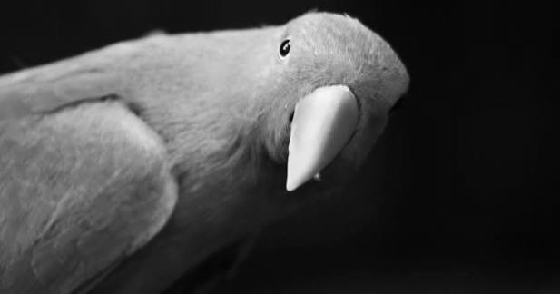
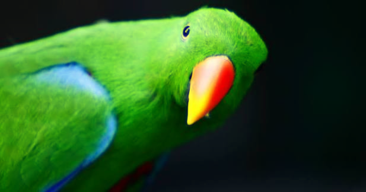
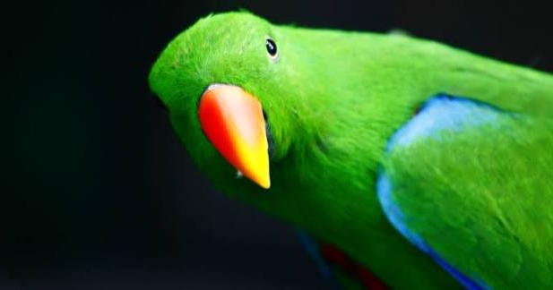

# Image Filter Project

A C++ project that loads an image, applies filters to it, and saves the result. The code is split into small classes so each part (pixels, images, filters, users, file handling, interface) lives in its own folder.

> **Status:** The filters work. Running the program reads every image in `examples/input/`, applies each filter and saves the results in `examples/output/`.

| Input | Grayscale | Blue blur | Flip horizontal |
|---|---|---|---|
|  |  |  |  |

## Overview

This program reads a PNG or JPG image into a grid of pixels, changes the pixels with a filter class, and writes the new image as a PNG. It is meant for learning how pixels, images and filters work in C++. Each filter is its own class, so adding a new one means adding one new class.

## Table of Contents

- [Quick Start](#quick-start)
- [Features](#features)
- [Project Structure](#project-structure)
- [Getting Started](#getting-started)
- [Usage](#usage)
- [Configuration](#configuration)
- [Filters](#filters)
- [Design Overview](#design-overview)
- [Data Files](#data-files)
- [Sample Images](#sample-images)
- [Troubleshooting](#troubleshooting)
- [Contributing](#contributing)
- [Roadmap](#roadmap)
- [License](#license)
- [Credits](#credits)

## Quick Start

Install the compiler on Ubuntu:

```bash
sudo apt install build-essential
```

Compile the code into an executable called `app`, then run it. Run both from the project root:

```bash
g++ -std=c++17 -Isrc/core -Isrc/filters -Isrc/users -Isrc/io -Isrc/ui -Ithird_party src/*.cpp src/*/*.cpp -o app
./app
```

You should see this, and 76 images appear in `examples/output/`:

```
All objects created successfully!
Saved examples/output/blue_jay/blue_jay_red_only.png
Saved examples/output/blue_jay/blue_jay_green_only.png
...
```

## Features

- Reads images from disk and writes the result as PNG
- Filter classes that share one common base class
- Separate Admin and Customer user types
- Session classes to track a filter run
- Plain C++17, no external libraries to install

## Project Structure

```
.
├── README.md
├── .gitignore
├── Makefile
├── third_party/        stb_image.h, stb_image_write.h
├── data/               text files read by the program
├── examples/
│   ├── input/          images to test with
│   └── output/         images the program writes
├── docs/               extra documentation
└── src/
    ├── main.cpp
    ├── core/           Pixel, Image, FilterSession, Session, Schedule, Sampler
    ├── filters/        Filter.h and the filter classes
    ├── users/          User.h, Admin, Customer
    ├── io/             File, File_Horizontal, File_Vertical, Catalog, Image_file_manager
    └── ui/             Interface
```

## Getting Started

### Prerequisites

- A C++ compiler that supports C++17 (for example `g++` 9 or newer)
- `make`

On Ubuntu you can install both with:

```bash
sudo apt install build-essential
```

### Build

With `g++` directly (run from the project root), this creates the executable `app`:

```bash
g++ -std=c++17 -Isrc/core -Isrc/filters -Isrc/users -Isrc/io -Isrc/ui -Ithird_party src/*.cpp src/*/*.cpp -o app
```

Then run the executable:

```bash
./app
```

It must be run from the project root, because the image paths (`examples/input/`, `examples/output/`) are relative.

With `make`:

```bash
make
```

This compiles every `.cpp` file under `src/` and creates the program at `build/app`.

### Run

```bash
make run
```

### Clean

```bash
make clean
```

## Usage

`main.cpp` creates one object of each class, then reads every image in `examples/input/`, applies each filter to a copy of it and saves the result in `examples/output/<image>/`. Image loading and saving go through the `IO` class in `src/io/Image_file_manager.h`. To use one filter by hand:

```cpp
IO io;
Image* img = io.imageread((char*)"examples/input/small_flower.png");
Invert filter;
filter.setImage(img);   // tell the filter which image to change
filter.applyFilter();   // changes img in place
io.imagewrite((char*)"examples/output/result.png", img);
```

`imageread` returns `nullptr` if the file cannot be loaded. `imagewrite` returns 0 if it fails.

## Configuration

The settings are set in code, not with environment variables or config files. `main.cpp` sets the values shown in the last column.

| Setting | Class | Default | What it changes | Set in `main.cpp` |
|---|---|---|---|---|
| `intensity` | `Blue_Blur` | 0 | Pixels averaged on each side of a pixel. A negative value becomes 0 | 5 (11 x 11 box) |
| `level` | `Brightness_Adjust` | 0 | Value added to red, green and blue. It is kept between -255 and 255 | 50 and -50 |
| `enabled` | `Grayscale`, `Invert`, `Red_Channel_Only`, `Green_Channel_Only`, `Blue_Channel_Only` | false | Stored only. `applyFilter()` does not check it | not set |
| input folder | `main.cpp` | `examples/input` | Where the images are read from | fixed |
| output folder | `main.cpp` | `examples/output` | Where the results are written | fixed |

## Filters

All filters inherit from `Filter` (`src/filters/Filter.h`), which requires every filter to provide `applyFilter()`. Call `setImage()` first so the filter knows which image to change. `applyFilter()` changes that image in place.

| Class | Purpose | Setting |
|---|---|---|
| `Red_Channel_Only` | Keep only the red values | none |
| `Green_Channel_Only` | Keep only the green values | none |
| `Blue_Channel_Only` | Keep only the blue values | none |
| `Blue_Blur` | Blur the blue values | `intensity` (pixels on each side, so 5 gives an 11 x 11 box) |
| `Grayscale` | Turn the image gray | none |
| `Invert` | Flip every color to its opposite | `enabled` |
| `Brightness_Adjust` | Make the image brighter or darker | `level` |
| `Flip_Horizontal` | Mirror left to right | none |
| `Flip_Vertical` | Mirror top to bottom | none |

## Design Overview

- **Pixel** holds one red, green and blue value.
- **Image** holds a grid of pixels with a width and a height.
- **Filter** is the base class. Each filter changes an image in its own way.
- **Session** stores an ID, a start time and an end time. **FilterSession** extends it and remembers which image and which filter were used.
- **User** is the base class for **Admin** and **Customer**.
- **File** stores width, height, path and format. **File_Horizontal** and **File_Vertical** extend it with an orientation.
- **IO** (in `Image_file_manager`) does the actual reading and writing of image files using the stb libraries.

## Data Files

| File | Purpose |
|---|---|
| `data/catalog.txt` | List of items in the catalog |
| `data/customers.example.txt` | Example of the customer file format. Copy it to `customers.txt` to use it |
| `data/sessions.txt` | Saved sessions |
| `data/blocked_cnics.txt` | Blocked customer IDs |

`data/customers.txt` is listed in `.gitignore` so real customer data is never committed.

## Sample Images

Test images are in `examples/input/`. Reference results are in `examples/output/`, one folder per image. Use PNG or JPG files without transparency. The reader always loads 3 channels (red, green, blue), so transparent areas lose their alpha value.

| Image | Size | What it tests |
|---|---|---|
| `gradient_bw.jpg` | 531 x 376 | Grayscale and brightness, clamping at 0 and 255 |
| `blue_jay.jpg` | 387 x 516 | Blue channel and blue blur, odd width |
| `bright_kite.jpg` | 678 x 452 | Very bright image, brightness going down |
| `dark_tree.jpg` | 738 x 414 | Very dark image, brightness going up |
| `sharp_owl.jpg` | 697 x 439 | Blur on sharp edges and fine detail |
| `odd_size_staircase.jpg` | 417 x 626 | Odd width, tall image, flips |
| `small_flower.png` | 99 x 102 | Small image for fast debugging, PNG input |
| `turtle_patch.jpg` | 485 x 599 | Strong separate colors, channel filters |
| `flip_parrot.jpg` | 617 x 324 | Flips, because left and right look different |

Each output is named `<image>_<filter>.png`. The filters used are `red_only`, `green_only`, `blue_only`, `grayscale`, `invert`, `brightness_plus50`, `brightness_minus50` and `blue_blur`. The flips `flip_horizontal` and `flip_vertical` are made only for `flip_parrot` and `odd_size_staircase`.

These outputs are made by this C++ program (`main.cpp` and the filter classes). Grayscale uses the weights 0.299, 0.587 and 0.114. Blue blur is an 11 x 11 box blur on the blue values, and pixels outside the image use the nearest edge pixel. Brightness adds or subtracts 50 and clamps to 0 to 255.

## Troubleshooting

**`fatal error: Pixel.h: No such file or directory`**
The `-I` flags are missing from the compile command. Use the full command from [Quick Start](#quick-start).

**`examples/input not found. Run the program from the project root.`**
The program was started from another folder. Run `cd` to the project root, then `./app`.

**`Failed to load image`**
The file in `examples/input/` is not a readable PNG or JPG, or the path is wrong. The program skips that file and continues with the others.

## Contributing

1. Fork the repository and create a branch.
2. Make your change and compile with the command in [Quick Start](#quick-start).
3. Run `./app` and look at the images in `examples/output/`. There are no automated tests yet.
4. Open a pull request that says what you changed.

## Roadmap

- [x] Write the pixel logic inside each filter's `applyFilter()`
- [x] Connect `Filter` to `Image` so a filter receives the image it works on
- [x] Add the missing filters
- [ ] Load and save the text files in `data/`
- [ ] Build the menu in `Interface`
- [ ] Add tests with sample images

## License

No license has been chosen for this project yet.

## Credits

- [stb_image and stb_image_write](https://github.com/nothings/stb) by Sean Barrett, public domain
